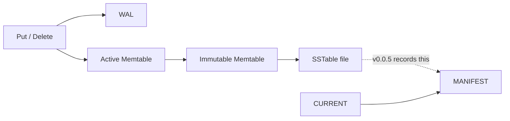
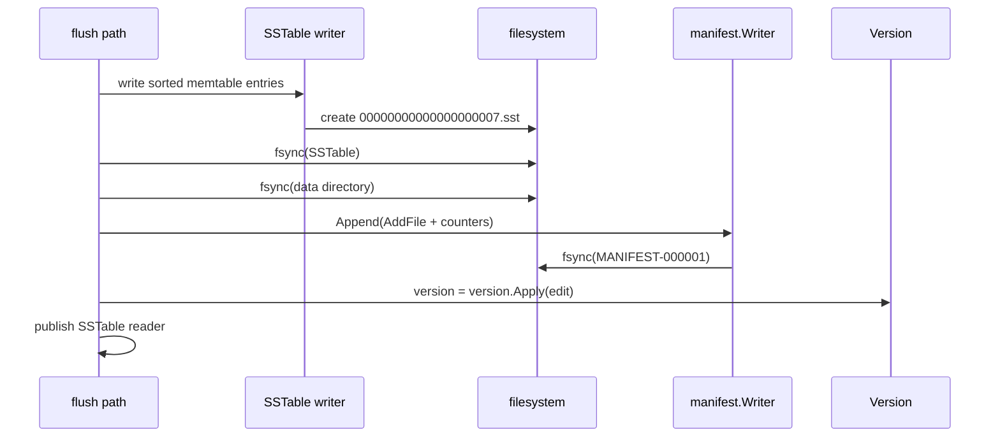
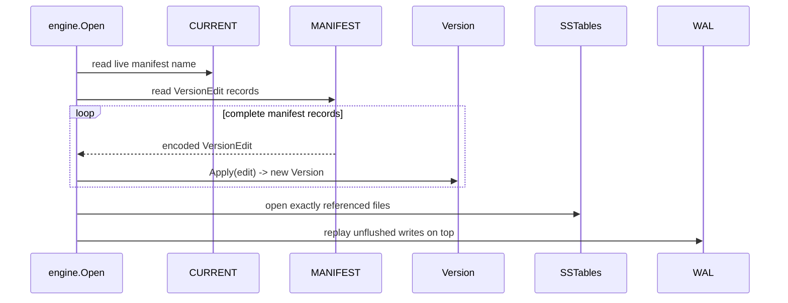
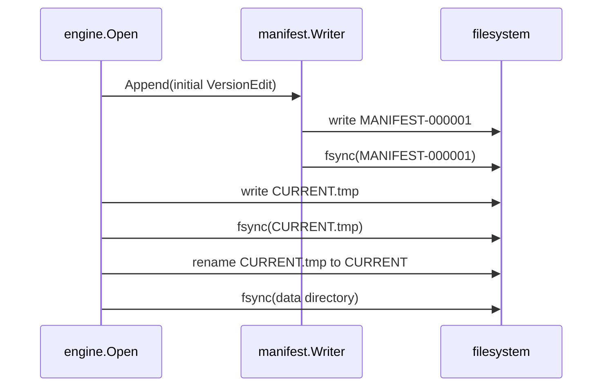

## My files were correct; my database was still broken

After the SSTable milestone, BeachDB could write real database files.

A full memtable became an immutable sorted file on disk. The engine could reopen that file. Reads could search through it. That felt like a big step because it was one: the disk plane finally existed.

But there was still an awkward question hiding under the floorboards:

> How does the database know which SSTable files count?
{: .prompt-tip }

Before this milestone, the answer was basically: scan the directory, find every `*.sst` file, sort them by file number, and open them.

That sounds reasonable until you remember that files can exist for reasons other than "this file is part of the current database state."

A process can crash after creating an SSTable but before publishing it. A future compaction can leave old files behind until cleanup runs. A human can copy a file into the directory because humans are entropy with keyboards.

At that point, "there is an `.sst` file on disk" is not enough information. The file might be data. It might be garbage. It might be a half-finished artifact from a failed flush.

The database needs durable metadata that says: these files belong to the current state.

That metadata is the manifest.

This post is about the new BeachDB manifest in `v0.0.5`: what problem it solves, how it changes startup and flushing, what the file format looks like byte by byte, how `manifest_dump` inspects it, and why the design looks like a small cousin of LevelDB, RocksDB, and Pebble.

The story is useful. The bytes are the point.

## A quick recap

[In the SSTable post](), `v0.0.3` made the on-disk state real. BeachDB learned how to flush a memtable into immutable sorted files, reopen those files, and serve reads from disk.

That gave the engine this shape:

```text
WAL -> active memtable -> immutable memtable -> SSTable files
```

But the flushed side still had a hole in it. SSTables existed, but the database still did not have a durable inventory of which SSTables belonged to the current database state.

The missing edge looked like this:



This is not compaction yet. All flushed files still land in level 0. But the manifest gives BeachDB the metadata layer that compaction will later mutate.

Without it, compaction would have nowhere safe to say: delete these old files, add this new file, and make that transition atomic.

## So, what is a manifest?

A manifest is an append-only log of metadata changes.

The WAL answers a write question:

> Which user writes happened recently and may need to be replayed?
{: .prompt-info }

The manifest answers a file-set question:

> Which SSTables exist, at which level, with which key ranges, and what are the current counters?
{: .prompt-info }

Together, they rebuild the database on startup:

```text
Manifest -> flushed SSTable state
WAL      -> unflushed recent writes
```

BeachDB's manifest has three pieces:

1. `CURRENT`: a tiny text file containing the name of the live manifest.
2. `MANIFEST-NNNNNN`: an append-only record log of metadata edits.
3. `Version`: the in-memory snapshot rebuilt by replaying those edits.

On disk, a BeachDB directory now looks like this:

```text
data/
├── CURRENT
├── MANIFEST-000001
├── beachdb.wal
├── 00000000000000000001.sst
├── 00000000000000000002.sst
└── ...
```

`CURRENT` contains one line:

```text
MANIFEST-000001
```

That indirection is not decoration. In the future, BeachDB can rotate the manifest by writing a fresh compacted manifest file and atomically swinging `CURRENT` to point at it. `v1` does not rotate yet, but the recovery path starts through `CURRENT` from day one.

Retrofitting that later would be exactly the sort of metadata migration that ruins a weekend.

## What changed in BeachDB

The public API did not change.

`Put`, `Get`, `Delete`, and `Flush` still mean what they meant before. A user does not call "add this SSTable to the manifest." The engine owns that.

The internal path changed:

- `internal/manifest` now owns `CURRENT`, `MANIFEST`, `VersionEdit`, `Version`, `Reader`, and `Writer`.[^2]
- `engine.Open` no longer discovers SSTables by scanning the directory.
- `Flush` no longer publishes an SSTable just because the file exists.
- `db.seqno` and `db.nextSSTID` are restored from manifest counters instead of being guessed from files on disk.

That last bit is easy to under-appreciate.

Sequence numbers are part of read correctness. File IDs are part of file naming and cleanup correctness. If either one moves backward after restart, the database can produce bugs that look polite at first and then ruin your afternoon.

The manifest checkpoints both:

```text
NextFileID   -> next SSTable file number to allocate
LastSequence -> highest database sequence number seen so far
LogNumber    -> WAL number associated with the edit
```

`LogNumber` is boring in `v1` because BeachDB still has one WAL file. It is still in the format because the manifest is where log lifecycle metadata belongs once WAL rotation exists.

The important architecture change is this:

```text
Before:
  directory scan -> open every canonical .sst file

After:
  CURRENT -> MANIFEST -> Version -> open referenced SSTables
```

The directory can now contain debris. The database state is not "whatever files happen to be nearby." It is the manifest plus the WAL.

That is the whole upgrade in one sentence.

## The write path: making a file count

Now let's follow the path that makes the manifest matter at runtime.

When a memtable flush completes, BeachDB has a new SSTable reader plus the metadata needed to describe the file:

- file ID
- file size
- smallest internal key
- largest internal key
- level 0

The publish order is:

```text
write SSTable
fsync SSTable
fsync data directory
append manifest VersionEdit
fsync manifest
apply edit to in-memory Version
install SSTable reader
```

Never reverse the SSTable sync and the manifest sync.

If the manifest is synced first, it can promise a file that may not be durable. That is the bad failure mode: recovery expects a file that may have never made it to stable storage.

If the SSTable is synced first and the process dies before the manifest edit, the file becomes an orphan. That is safe. Wasteful, but safe.



The manifest edit for a successful flush looks conceptually like this:

```text
VersionEdit{
  NextFileID:   8,
  LastSequence: 42,
  AddedFiles: [
    level=0 fileID=7 size=170
    smallest="apple/40/Put"
    largest="zebra/42/Put"
  ],
}
```

The SSTable file is already durable before this edit is appended. `manifest.Writer.Append` writes the record and syncs the manifest file. Only after that does BeachDB apply the edit to the in-memory `Version` and publish the reader to the read path.

`Version.Apply` is immutable. It returns a new `Version` instead of mutating the old one in place.

That is more machinery than BeachDB strictly needs today, but it is the right foundation for the next milestones. Once iterators and snapshots exist, a reader may need to hold a stable view of "which files existed when I started." If a flush mutates that version under the reader, congratulations, you have invented a subtle bug with a long tail and terrible manners.

Immutable versions make the future read path less weird.

## Recovery: rebuilding the file set

Startup now has two jobs:

1. Rebuild the flushed SSTable state from the manifest.
2. Replay the WAL on top for recent unflushed writes.

The order matters.



On a fresh database, there is no `CURRENT`. That means no manifest has been committed yet, so BeachDB bootstraps one.

The fresh path is:

1. Create an empty in-memory `Version`.
2. Pick the next available manifest filename, usually `MANIFEST-000001`.
3. Append one initial `VersionEdit` with `NextFileID = 1`, `LastSequence = 0`, and `LogNumber = 0`.
4. Sync the manifest file.
5. Atomically install `CURRENT`.

The `CURRENT` install uses the usual crash-safe dance:

```text
write CURRENT.tmp
fsync CURRENT.tmp
rename CURRENT.tmp -> CURRENT
fsync parent directory
```

The rename is atomic. The directory `fsync` makes the rename durable. Without that last syscall, the rename can be visible to the running process but disappear after a crash. I have already been bitten by directory `fsync` once. I am trying not to make it a recurring character.



`CURRENT` is the commit point. If the process crashes before `CURRENT` is installed, the directory still looks fresh on the next open. If a half-created `MANIFEST` file is left behind without `CURRENT` pointing to it, BeachDB treats it as an orphan manifest and bootstraps a new one using the next available manifest ID.

That last detail matters. Reusing `MANIFEST-000001` with append mode after a failed bootstrap would be a lovely way to stitch garbage bytes and valid metadata into one cursed file.

On an existing database, BeachDB reads `CURRENT`, opens the named manifest, and replays every complete manifest record into a fresh `Version`.

If the manifest ends with a truncated trailing record, recovery treats it as a crash during append. The reader stops at the last valid record and truncates the manifest back to that boundary. That is safe because `manifest.Writer.Append` syncs the file before the edit counts as durable.

But not every problem is recoverable:

- Bad magic: hard error.
- Unsupported version: hard error.
- Checksum mismatch: hard error.
- Unknown `VersionEdit` tag: hard error.
- Manifest references a missing SSTable: hard error.

A missing SSTable promised by the manifest is different from a truncated WAL tail. A truncated WAL tail usually means the process died before acknowledging a write. Fine. Discard it.

A missing SSTable promised by the manifest means something broke the database contract. The flush path syncs the SSTable before syncing the manifest edit. If the manifest says the file exists and the file is gone, continuing would hide corruption.

This is one of those rules that feels harsh until the alternative is silently losing data.

## Orphans: files outside the manifest

The flip side is an SSTable that exists on disk but is not referenced by the manifest.

That file is an orphan.

The most common path is:

1. Flush writes a new SSTable.
2. Flush syncs the SSTable file.
3. Flush syncs the parent directory.
4. Process dies before the manifest edit is appended and synced.

After restart, the file exists, but the manifest never promised it. So the database ignores it. In `v0.0.5`, startup also performs best-effort cleanup for canonical SSTable filenames that are not referenced by the recovered `Version`.

The rule is simple:

> Referenced files are required. Unreferenced files are debris.
{: .prompt-info }

If a file is referenced by the manifest and missing on disk, startup fails. If a file exists on disk and is not referenced by the manifest, startup can delete it.

This gives BeachDB an actual ownership model. The directory can contain debris. The database state is the manifest plus WAL, not a directory scan of whatever filenames happen to be nearby.

## The manifest file format

Now that the engine path is on the table, let's crack the file open.

A manifest file is a sequence of records. The record envelope is shared with the WAL, but the magic bytes and payload type are different.[^1]

```text
[magic:8][version:1][type:1][length:4][checksum:4][payload:N]
```

The header is 18 bytes total:

| Field | Size | Manifest value |
|-------|------|----------------|
| `magic` | 8 bytes | ASCII `BEACHMAN` |
| `version` | 1 byte | `0x01` |
| `type` | 1 byte | `0x01` for full record |
| `length` | 4 bytes | payload length, big-endian |
| `checksum` | 4 bytes | CRC32C of payload, big-endian |
| `payload` | N bytes | encoded `VersionEdit` |

The WAL uses the same envelope with `BEACHWAL` and an encoded `Batch` payload. The manifest uses `BEACHMAN` and an encoded `VersionEdit` payload.

Different magic bytes mean `wal_dump` rejects a manifest file and `manifest_dump` rejects a WAL. That sounds small until you are staring at a corrupted file at 1 AM and need the tool to fail immediately instead of doing interpretive dance with random bytes.

### The `VersionEdit` payload

The unit of change in the manifest is a `VersionEdit`.

It is the metadata cousin of a write batch. A batch says: put this key, delete that key. A `VersionEdit` says: add this SSTable, delete that SSTable, advance this counter.

In `v1`, an edit can carry:

- `AddFile`: level, file ID, file size, smallest key, largest key
- `DeleteFile`: level and file ID
- `NextFileID`: the next SSTable file number to allocate
- `LastSequence`: the highest database sequence number seen so far
- `LogNumber`: the WAL number associated with the edit

Every field is optional. That matters because most metadata changes are small. A flush usually adds one file and advances counters. A future compaction will delete a few files and add a few files. There is no reason to rewrite a full manifest snapshot every time one file enters the database.

The payload is a small tag-value encoding:

```text
VersionEdit Encoding (v1)
=========================

Each field in a VersionEdit is optional. Encode only fields that are set.
For each set field, write:
  [tag: 1 byte][field payload]

Tag values:
  1 = AddFile:      [level: uint32][fileID: uint64][size: uint64]
                    [smallestKey: uint32 length + bytes]
                    [largestKey:  uint32 length + bytes]
  2 = DeleteFile:   [level: uint32][fileID: uint64]
  3 = NextFileID:   [value: uint64]
  4 = LastSequence: [value: uint64]
  5 = LogNumber:    [value: uint64]
```

All integers are big-endian. No padding. No cleverness hiding in the margins.

`Encode()` writes fields in a deterministic order:

1. `NextFileID`, if set.
2. `LastSequence`, if set.
3. `LogNumber`, if set.
4. `DeleteFile` entries, in input order.
5. `AddFile` entries, in input order.

That means the same `VersionEdit` produces the same bytes every time. Counters come before file deltas, following the same broad convention LevelDB uses.[^4]

The decoder hard-errors on unknown tags in `v1`. Skipping unknown fields sounds nice, but it requires either a length prefix on every tag or a decoder that knows how to skip every future field shape. I do not need that machinery yet.

No silent improvisation. Storage formats should not guess.

### A byte layout example

Suppose we encode this edit:

```text
NextFileID = 42
LastSequence = 100
AddFile{
  level=0
  fileID=7
  size=1024
  smallestKey="apple/40/Put"
  largestKey="zebra/42/Put"
}
```

The key fields store encoded BeachDB internal keys: `[userKey][seqno:8][kind:1]`.

The `VersionEdit` payload is 75 bytes:

```text
Offset  Hex                          Meaning
------  ---                          -------
0       03                           tag = NextFileID
1..8    00 00 00 00 00 00 00 2A      uint64 BE = 42
9       04                           tag = LastSequence
10..17  00 00 00 00 00 00 00 64      uint64 BE = 100
18      01                           tag = AddFile
19..22  00 00 00 00                  level (uint32) = 0
23..30  00 00 00 00 00 00 00 07      fileID (uint64) = 7
31..38  00 00 00 00 00 00 04 00      size (uint64) = 1024
39..42  00 00 00 0E                  smallestKey length (uint32) = 14
43..47  61 70 70 6C 65               smallest user key bytes = "apple"
48..55  00 00 00 00 00 00 00 28      smallest seqno (uint64) = 40
56      01                           smallest kind = Put
57..60  00 00 00 0E                  largestKey length (uint32) = 14
61..65  7A 65 62 72 61               largest user key bytes = "zebra"
66..73  00 00 00 00 00 00 00 2A      largest seqno (uint64) = 42
74      01                           largest kind = Put
```

Wrapped by the 18-byte record header, the full on-disk manifest record is 93 bytes.

That is the part I care about. Not "the manifest stores metadata" as a hand-wave. This exact edit becomes this exact byte sequence, inside this exact record envelope, with this exact checksum boundary.

Being able to point at bytes is how a file format stops being a bedtime story.

## `manifest_dump` is not optional tooling

As usual, I do not trust a format until I can dump it.

`v0.0.5` adds `manifest_dump`, the metadata sibling of `wal_dump` and `sst_dump`.[^3] It reads `CURRENT`, opens the live manifest, prints every `VersionEdit`, applies the edits in order, and then prints the reconstructed `Version`.

Here is sample output:

```text
$ manifest_dump /tmp/beachdb-example-manifest
Manifest: MANIFEST-000001
Path:     /tmp/beachdb-example-manifest/MANIFEST-000001

Edit #0:
  next_file_id:  1
  last_sequence: 0
  log_number:    0
Edit #1:
  next_file_id:  2
  last_sequence: 2
  add_file:    level=0 id=1 size=170 smallest="apple/1/Put" largest="apricot/2/Put"
Edit #2:
  next_file_id:  3
  last_sequence: 4
  add_file:    level=0 id=2 size=178 smallest="banana/3/Put" largest="blueberry/4/Put"

Current Version:
  Level 0: 2 files (348 bytes total)
    [1] apple..apricot (170 bytes)
    [2] banana..blueberry (178 bytes)
```

The useful part is not just the final state. The tool shows how the engine got there: bootstrap counters, add file 1, add file 2, rebuild the current version.

If the manifest is corrupt, the tool follows the same policy as the engine: print what was valid, report the edit where replay failed, and exit non-zero.

When something goes wrong in a storage engine, "the API returned X" is usually not enough. You want to know:

- did the manifest record get written?
- did the checksum pass?
- which edit was the last valid one?
- which SSTables does replay actually reference?
- did startup infer state from evidence or from vibes?

The last one is only half a joke.

## Testing, or how I convinced myself this is not lying

This milestone touched startup, flushing, file naming, binary encoding, truncation recovery, corruption handling, and cleanup. So the tests had to cover a few layers.

At the format layer:

- `VersionEdit` round-trips with all fields set
- partial edits round-trip with only some fields set
- empty edits encode and decode cleanly
- multiple added and deleted files work in one edit
- unknown tags hard-error
- truncated fields hard-error
- oversized length-prefixed key fields are rejected
- random decode inputs do not panic

At the manifest log layer:

- writer appends records and syncs
- reader yields edits in order
- an existing manifest with no `NextFileID` counter is rejected as corrupt
- truncated tails are recoverable
- checksum corruption is fatal
- bad magic is fatal

At the engine layer:

- fresh open creates `CURRENT` and `MANIFEST-000001`
- existing open replays the manifest
- empty `CURRENT` is fatal
- `CURRENT` pointing at a missing manifest is fatal
- path traversal in `CURRENT` is rejected
- orphan manifests are ignored unless `CURRENT` points at them
- missing SSTable promised by the manifest is fatal
- duplicate `AddFile` is fatal
- orphan `DeleteFile` is tolerated
- flush writes a manifest edit
- `NextFileID` survives restart
- `LastSequence` survives restart
- flushed data survives even if the WAL is removed
- flushed SSTables plus unflushed WAL writes recover together
- orphan SSTables are removed on reopen

That last one is the new behavior I wanted to lock down carefully.

The test is:

1. Write a key and flush it to SSTable `1`.
2. Delete the WAL so recovery must come from manifest plus SSTable.
3. Plant a junk canonical SSTable file at ID `2`.
4. Reopen.
5. Verify file `2` is removed.
6. Verify the key from SSTable `1` still reads correctly.
7. Flush again and confirm ID `2` can be reused safely.

That is the manifest contract in miniature: referenced files count; orphan files do not.

## Design notes

Now that the concrete shape is visible, the interesting question is why it looks this way.

The short version: I wanted the LevelDB/RocksDB/Pebble style of metadata log, but scaled down to BeachDB's current shape.[^4][^5][^6][^7]

Not copied wholesale. That would be cosplay. Modeled after the part that matters.

### A log of edits, not a full snapshot

The simplest possible manifest would be a full snapshot: serialize the current file set, write it to a temp file, sync it, rename it into place.

That is tempting because recovery reads one object and is done.

I did not choose that for BeachDB v1.

A log of edits makes each metadata change proportional to the change itself. A flush adds one file, so it writes one `AddFile` edit. A future compaction will delete some files and add some files, so it can write one edit containing exactly that transition.

It also gives `manifest_dump` an audit trail: not just "here is the current state," but "here is how the database got here."

That matched the LevelDB/Pebble-style path better than a snapshot-only format.[^4][^7]

### `CURRENT` exists before rotation does

`v1` never rotates the manifest. It could technically hardcode `MANIFEST-000001` and get away with it for now.

I still added `CURRENT`.

The reason is that rotation changes the bootstrap problem. Eventually, BeachDB will want to write a compacted manifest and atomically switch from the old one to the new one. A tiny pointer file is the clean atomic object: write `CURRENT.tmp`, sync it, rename it, sync the directory.

If that indirection is part of the format from day one, recovery always starts the same way. If it is retrofitted later, the database has to support two boot protocols for old and new directories.

That sounds like "not today" until it becomes "why is recovery full of archaeology?"

### Reuse the record layer

The framing problem is identical for the WAL and the manifest: variable-length payloads with magic bytes, version, record type, payload length, and checksum.

Solving it twice would mean two readers, two writers, two sets of truncation tests, and two ways for me to make the same mistake with different variable names.

So BeachDB uses a shared `internal/record` package:

| File | Magic | Payload |
|------|-------|---------|
| WAL | `BEACHWAL` | encoded `Batch` |
| MANIFEST | `BEACHMAN` | encoded `VersionEdit` |

The record layer knows how to reject bad magic, unsupported versions, unsupported record types, oversized payloads, truncated records, and checksum mismatches. It does not know what a batch is. It does not know what a `VersionEdit` is.

Semantic meaning lives inside the payload. Record safety lives around it.

LevelDB and RocksDB use their log reader/writer infrastructure for manifest records too. Pebble's explicit shared record package made the idea feel especially natural in Go.[^5][^7]

### TLV, but no skip-unknown machinery yet

`VersionEdit` uses tag-value encoding because edits are sparse. A flush edit does not need to write empty delete lists or future compaction fields. It writes the fields it actually sets.

But `v1` does not try to skip unknown tags. That would require every tag to be length-delimited, even fixed-width ones, or a decoder that knows how to skip every future field shape.

That is forward-compatibility theater unless there is a real future field to support.

So the rule is stricter and simpler: unknown tag means "this manifest is not for this reader." The format version byte is the escape hatch.

### Manifest sync is not optional

The WAL has configurable sync behavior because write latency is a user-facing tradeoff. The manifest does not get that knob.

Every manifest append is synced. Metadata changes are infrequent compared to user writes, and the manifest entry is the thing that makes a newly flushed SSTable part of the database state.

If the SSTable is durable but the manifest edit is not, recovery can safely ignore the orphan. If the manifest edit is durable before the SSTable is durable, recovery may believe in a file that never survived.

That is the bad ordering. So the flush path pays the metadata sync cost.

### Missing promised files are corruption

WAL truncation and missing manifest-referenced SSTables are not the same kind of failure.

A truncated WAL tail usually means the process died mid-write. The caller never got success, so recovery can discard the partial record and move on.

A missing SSTable promised by the manifest means something violated the durable file-set contract. The manifest append happens after the SSTable file and parent directory are synced. If that file is gone later, BeachDB should not pretend everything is fine.

It should fail loudly.

### No rotation in v1

Manifest rotation is real work: write a compact replacement, install it safely, decide what to do with old manifests, and test every crash point in that sequence.

For `v0.0.5`, that is too much scope. The manifest can grow for now. The important thing is that the format already has the pointer file that makes future rotation possible.

The v1 rule is enough: one live manifest, append edits, replay on startup.

## Where this leaves BeachDB

Before this milestone, startup inferred state from the filesystem.

After this milestone, startup replays state from logs:

```text
CURRENT -> MANIFEST -> Version -> SSTable readers
WAL     -> active memtable
```

This is a better boundary. The database no longer asks the directory to explain itself. It asks its own metadata.

The manifest is not a flashy milestone. It does not add a new user-facing API. It does not make point reads faster. It does not compact anything.

It makes the engine less naive about its own files.

That is exactly the kind of small, unglamorous metadata layer databases are made of.

## What's next

Next up is the read path: merge iterators across memtables and SSTables, snapshot reads, and range scans.

Right now `Get` can search the active memtable, immutable memtable, and SSTables newest-first. That is enough for point lookups. It is not enough for a real ordered scan across multiple sorted sources, especially once snapshots enter the picture.

The manifest gives the read path a stable file set to stand on. Now the read path has to earn it.

After that: read acceleration, bloom filters, block caching, and then compaction. The manifest will become more interesting when compaction starts producing edits that delete old files and add new files in one atomic metadata step.

Until we meet again.

Adios! ✌🏼

---

## Notes & references

[^1]: BeachDB manifest format specification: [`docs/formats/manifest.md`](https://github.com/aalhour/beachdb/blob/v0.0.5/docs/formats/manifest.md)
[^2]: BeachDB manifest package: [`internal/manifest`](https://github.com/aalhour/beachdb/tree/v0.0.5/internal/manifest)
[^3]: BeachDB manifest dump tool: [`cmd/manifest_dump`](https://github.com/aalhour/beachdb/tree/v0.0.5/cmd/manifest_dump)
[^4]: LevelDB's `VersionEdit` encoding lives in [`db/version_edit.h`](https://github.com/google/leveldb/blob/main/db/version_edit.h) and [`db/version_edit.cc`](https://github.com/google/leveldb/blob/main/db/version_edit.cc).
[^5]: LevelDB's manifest and version-set logic lives in [`db/version_set.cc`](https://github.com/google/leveldb/blob/main/db/version_set.cc).
[^6]: RocksDB's MANIFEST overview: [github.com/facebook/rocksdb/wiki/MANIFEST](https://github.com/facebook/rocksdb/wiki/MANIFEST)
[^7]: Pebble's manifest implementation is a useful Go reference: [`internal/manifest/version_edit.go`](https://github.com/cockroachdb/pebble/blob/master/internal/manifest/version_edit.go), and its shared record package lives under [`record`](https://github.com/cockroachdb/pebble/tree/master/record).
