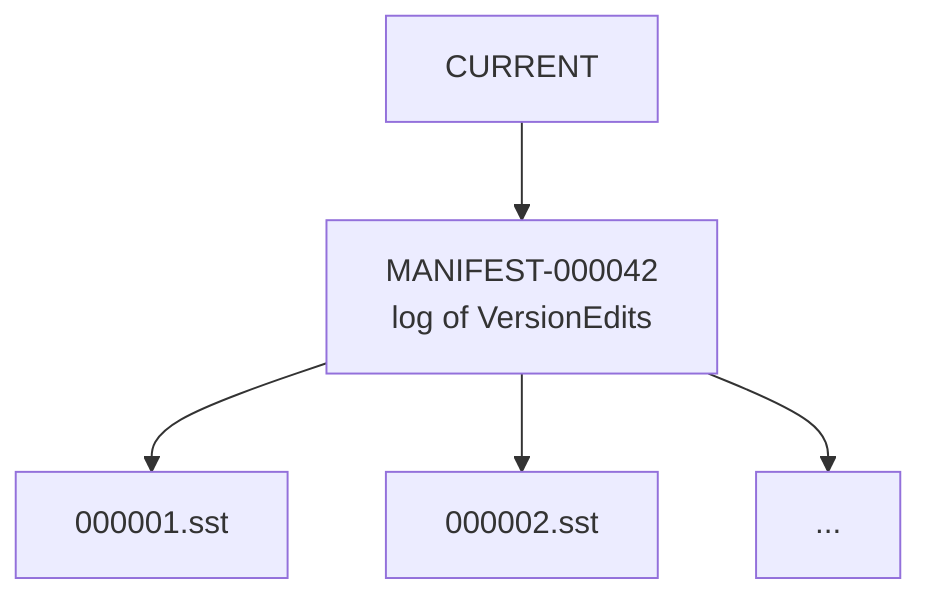
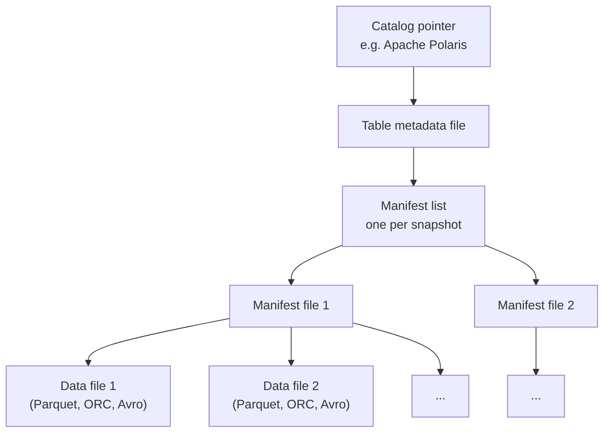
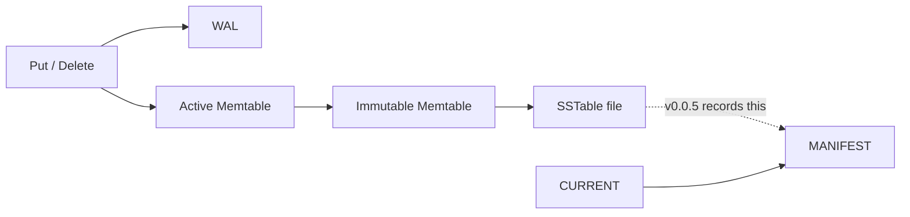
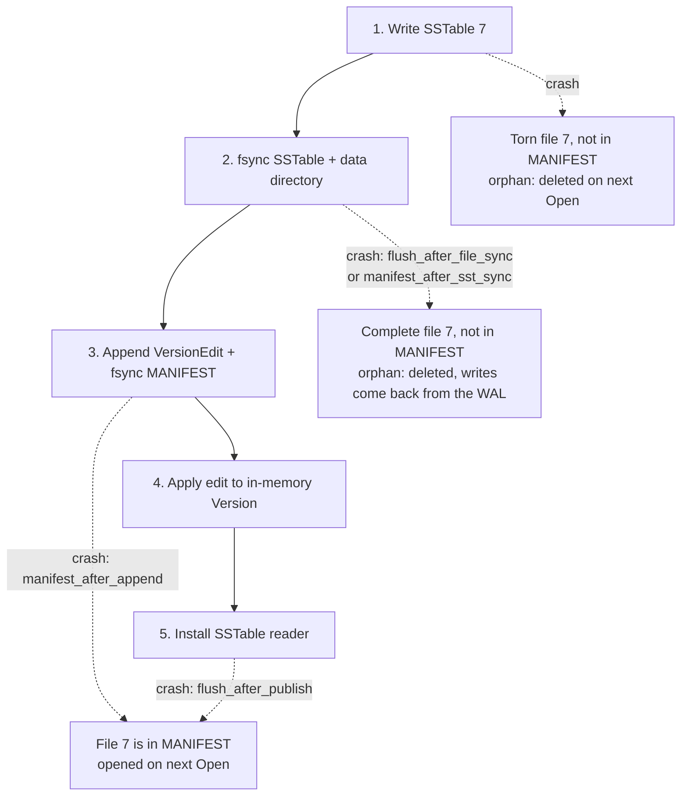
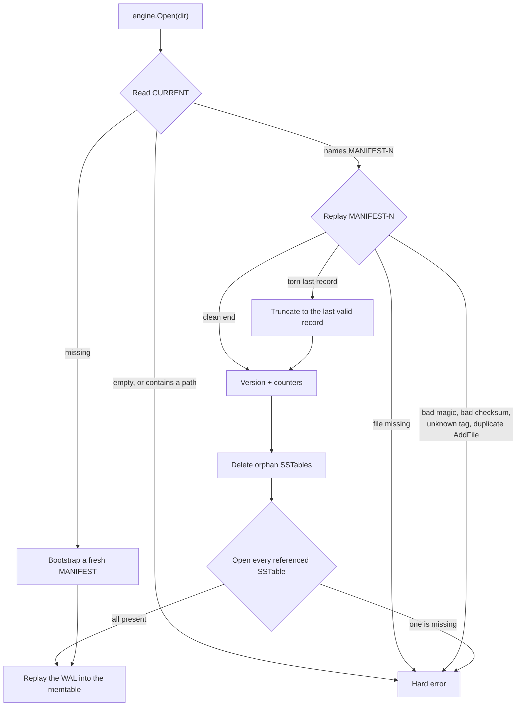
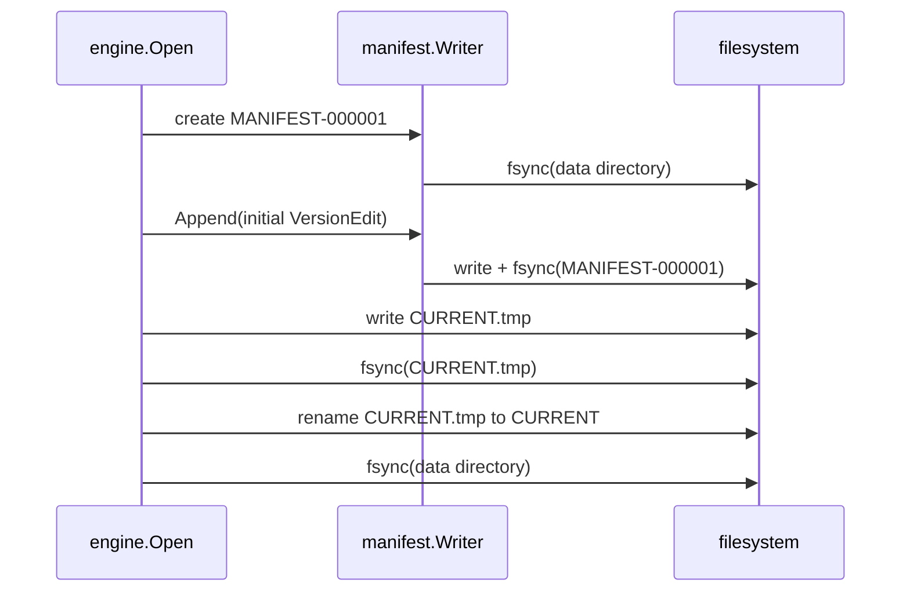

## Oh, it's been 6 months!

The manifest milestone shipped back in May, and it took more out of me than any BeachDB milestone so far. Most of that went into study: reading how LevelDB, RocksDB and Pebble solve the same problem, and working out which crash orderings are safe and which ones only look safe.

Then life happened, the good kind. I joined [Fivetran](https://www.fivetran.com/) as a Senior Staff Software Engineer on the Managed Data Lake product: a cloud-native data system built on Apache Iceberg, Apache Polaris, DuckDB and a pile of open data formats. I've been in the weeds ever since, learning how the whole thing fits together and shipping a lot of cool things I want to write about soon.

Funny enough, a big part of that system runs on manifests too. It's turtles all the way down, again.

But back to the milestone... :D

This post covers where manifests come from, the failure that made BeachDB need one, how startup and flushing change in [v0.0.5](https://github.com/aalhour/beachdb/releases/tag/v0.0.5), what the file looks like byte by byte, how `manifest_dump` inspects it, and what this milestone still doesn't do.

## A brief history of manifests

The word comes from shipping. A ship's manifest lists what's on board, so whoever is at the next port can check the cargo against the paperwork instead of opening every crate. Software borrowed the idea early: a Java JAR carries a `MANIFEST.MF`, and package managers keep manifests of what a package contains.

Data systems hit the same question as soon as data lives in many immutable files: **which of these files are the dataset right now?**

There are two ways to answer it. You can ask the directory: list the files and treat whatever is there as the data. Or you can keep a separate, durable record of which files belong, and treat everything else as noise.

Listing the directory is the obvious first answer, and it breaks the same way everywhere. Half-written files show up. Deleted files linger. Nothing makes "add these three files, drop those two" happen all at once. Hive-style tables, where a directory *is* the table, ran into this hard on object stores, where listing is slow and, for years, wasn't even consistent.

The fix keeps showing up in the same shape:

- **LSM storage engines.** LevelDB, open-sourced by Google in 2011, keeps a `MANIFEST` file: a log of edits saying which SSTables were added and removed, plus a tiny `CURRENT` file that names the live manifest.[^8] RocksDB inherited the design and grew it (manifest rotation, column families), and Pebble carries it over to Go.[^6][^7]
- **Table formats.** Apache Iceberg, which started at Netflix, replaced directory listing with a tree of metadata: a table metadata file points at one manifest list per snapshot, which points at manifest files, which list the data files.[^9] A commit writes new metadata, then swaps a single pointer in a catalog such as Apache Polaris.[^10] Delta Lake does something similar with an ordered log of JSON commits in `_delta_log`.[^11]

Different scales, same shape: one small pointer, a log or tree of metadata, and immutable data files that only count once the metadata says so.

The following is how the idea looks in an LSM engine like LevelDB, RocksDB or Pebble:



And the following is how the same idea looks in an Apache Iceberg table:



BeachDB's version is the first picture, scaled down: `CURRENT` points at `MANIFEST-000001`, which lists the `.sst` files.

> I'm preparing a separate post that digs into this history properly: where the idea came from, how it spread from storage engines to table formats, and what each system changed along the way. This section is the 10,000-ft version.
{: .prompt-info }

## Where we left off

[In the SSTable post](), `v0.0.3` taught BeachDB to flush a memtable into immutable sorted files, reopen them, and serve reads from disk:

```text
WAL -> active memtable -> immutable memtable -> SSTable files
```

[Then `v0.0.4`]() added a crash harness with failpoints at named engine boundaries. The last three rows of its failpoint table all pointed at the same missing piece: a manifest that defines which files the database owns.

That piece is this milestone. Here's the hole it fills:



> How does the database know which SSTable files count?
{: .prompt-monologue }

Before `v0.0.5`, the answer was: scan the directory, open every `*.sst` file, sort them by file number.

## One torn file

Here's what that answer costs.

`v0.0.4` writes each SSTable straight to its final filename, so a process that dies halfway through a flush leaves a torn `.sst` behind. I set that up by hand: one good flush, then a copy of that file chopped in half under the next file ID.

```text
$ ls -l data/
103  00000000000000000000.sst   # a good flush
 51  00000000000000000001.sst   # torn: the next flush died halfway
 37  beachdb.wal                # every acknowledged write
```

Then I reopened it with `v0.0.4`:

```text
beachdb: reading SSTable 00000000000000000001.sst: beachdb/sstable: invalid magic number
```

The WAL still had every acknowledged write. File `0` was fine. Every file the database needed was correct, and the database still refused to open, because of one file nobody asked for.

A stray file does the same thing. `v0.0.4` also refused to start if someone dropped a `backup.sst` into the data directory, because the scan tried to parse every `.sst` filename as a number. Humans are entropy with keyboards.

The directory scan can't tell data from debris. Only metadata the database writes and syncs itself can make that call, and that metadata is the manifest. With `v0.0.5`, the same directory opens, `Get("apple")` returns `"red"`, and the torn file gets deleted on the way in.

## So, what is a BeachDB manifest?

A manifest is an append-only log of metadata changes. BeachDB now rebuilds itself on startup from two logs that answer different questions:

| Log | Question it answers |
|-----|---------------------|
| WAL | Which user writes happened, and in what order? |
| MANIFEST | Which SSTables exist, at which level, with which key ranges, and what are the current counters? |

BeachDB's manifest has three pieces:

1. `CURRENT`: a tiny text file containing the name of the live manifest.
2. `MANIFEST-NNNNNN`: an append-only record log of metadata edits.
3. `Version`: the in-memory snapshot rebuilt by replaying those edits.

On disk, a BeachDB directory now looks like this:

```text
data/
├── CURRENT
├── MANIFEST-000001
├── beachdb.wal
├── 00000000000000000001.sst
├── 00000000000000000002.sst
└── ...
```

`CURRENT` contains one line:

```text
MANIFEST-000001
```

The indirection pays off later. Rotating the manifest means writing a fresh, compacted manifest and atomically swinging `CURRENT` to point at it. `v0.0.5` doesn't rotate yet, but recovery already starts at `CURRENT`, so the boot path won't change on the day rotation lands. Retrofitting a pointer file into existing databases is exactly the kind of metadata migration I'd rather never write.

## What changed in BeachDB

The public API didn't change. `Put`, `Get`, `Delete` and `Flush` mean what they meant before. Nobody calls "add this SSTable to the manifest"; the engine owns that.

The internals did:

- `internal/manifest` now owns `CURRENT`, `MANIFEST`, `VersionEdit`, `Version`, `Reader` and `Writer`.[^2]
- `engine.Open` no longer discovers SSTables by scanning the directory.
- `Flush` no longer publishes an SSTable just because the file exists.
- `db.seqno` and `db.nextSSTID` come back from manifest counters instead of being guessed from files on disk.
- The WAL and the manifest now share one record format in `internal/record`, which changed the WAL's on-disk header (more on that in the [design notes](#reuse-the-record-layer)).

The counters are easy to under-appreciate. Sequence numbers are part of read correctness: "newest wins" only works if newest never moves backward. File IDs are part of naming and cleanup: reuse one by accident and a flush can overwrite a file the database still needs. The manifest checkpoints both:

```text
NextFileID   -> next SSTable file number to allocate
LastSequence -> highest database sequence number seen so far
LogNumber    -> WAL number associated with the edit
```

`LogNumber` is always `0` in `v0.0.5`, because BeachDB still has exactly one WAL file. It's in the format anyway, because the manifest is where WAL lifecycle metadata belongs once the WAL starts rotating. That turns out to matter more than I expected; see [what v0.0.5 doesn't do yet](#what-v005-doesnt-do-yet).

Here's the architecture change, before and after:

```text
Before:
  directory scan -> open every canonical .sst file

After:
  CURRENT -> MANIFEST -> Version -> open referenced SSTables
```

The directory can contain debris now. The database state is the manifest plus the WAL, not whatever filenames happen to be nearby.

## The write path: making a file count

When a memtable flush finishes writing, BeachDB has a new SSTable reader plus the metadata that describes the file:

- file ID
- file size
- smallest internal key
- largest internal key
- level 0

The publish order is:

```text
write SSTable
fsync SSTable
fsync data directory
append manifest VersionEdit
fsync manifest
apply edit to in-memory Version
install SSTable reader
```

The one rule: never sync the manifest edit before the SSTable.

If the manifest goes first, it can promise a file that never made it to stable storage, and recovery will go looking for a file that isn't there. If the SSTable goes first and the process dies before the edit lands, the file is an orphan: wasted disk, nothing lost, and the next `Open` deletes it.

Here's what recovery finds if the process dies inside each step, along with the crash points wired into each window:



Every crash before the manifest edit is synced leaves an orphan. Every crash after it leaves a file that counts. There's no window where the manifest names a file that isn't durable.

The manifest edit for a successful flush looks conceptually like this:

```text
VersionEdit{
  NextFileID:   8,
  LastSequence: 42,
  AddedFiles: [
    level=0 fileID=7 size=170
    smallest="apple/40/Put"
    largest="zebra/42/Put"
  ],
}
```

`manifest.Writer.Append` writes the record and fsyncs the manifest. Only then does BeachDB apply the edit to the in-memory `Version` and hand the reader to the read path. If the append fails, the flush returns an error, the reader gets closed, and the file stays behind as an orphan; `nextSSTID` doesn't advance, so the ID is reused once the next `Open` cleans the orphan up.

`Version.Apply` returns a new `Version` instead of mutating the old one. BeachDB doesn't strictly need that today, but iterators and snapshots will: a reader that started before a flush needs a stable view of which files existed when it started. Mutate that view underneath it and you get the kind of bug that only shows up under load, months later.

## Recovery: rebuilding the file set

Startup has two jobs, in this order: rebuild the SSTable file set from the manifest, then replay the WAL into the memtable. The whole decision tree fits in one picture:



### Fresh databases

No `CURRENT` means no manifest was ever committed, so BeachDB bootstraps one:

1. Create an empty in-memory `Version`.
2. Pick the next available manifest filename, usually `MANIFEST-000001`.
3. Append one initial `VersionEdit` with `NextFileID = 1`, `LastSequence = 0`, and `LogNumber = 0`.
4. Sync the manifest file.
5. Atomically install `CURRENT`.

`CURRENT` goes in with the usual crash-safe dance:

```text
write CURRENT.tmp
fsync CURRENT.tmp
rename CURRENT.tmp -> CURRENT
fsync parent directory
```

The rename is atomic. The directory `fsync` makes it durable: without it, the rename is visible to the running process and can vanish after a crash. I've already been bitten by directory `fsync` [once](). I'm trying not to make it a recurring character.



`CURRENT` is the commit point. Crash before it's installed and the directory still looks fresh on the next open. A half-created `MANIFEST` left behind without `CURRENT` pointing at it is an orphan manifest: BeachDB ignores it and bootstraps under the next free manifest ID. Reusing `MANIFEST-000001` in append mode would stitch the orphan's garbage bytes and valid metadata into one cursed file.

### Existing databases

BeachDB reads `CURRENT`, opens the named manifest, and replays every complete record into a fresh `Version`.

A torn last record means the process died mid-append. The reader stops at the last valid record and truncates the file back to that boundary. That's safe because an edit only counts once `Append` has synced it, and a torn record never got that far.

Everything else is a hard error: bad magic, unsupported version, checksum mismatch, unknown `VersionEdit` tag, duplicate `AddFile`, or a manifest that references a missing SSTable.

That last one deserves a sentence. A torn WAL tail means the process died before acknowledging a write, so recovery discards it and moves on. A missing SSTable that the manifest promised means something broke the contract, because the flush path syncs the file before the edit. Opening anyway would hide corruption, so BeachDB refuses.

## Orphans: files outside the manifest

The flip side is an SSTable on disk that the manifest never mentions. The usual way to get one: the flush writes and syncs the SSTable and the directory, then the process dies before the manifest edit is synced.

After restart, the file exists but nothing promised it, so the database ignores it. `v0.0.5` also deletes it, best-effort, if the name is a canonical SSTable filename (20 digits plus `.sst`) that the recovered `Version` doesn't reference. A `backup.sst` gets left alone, which beats refusing to start.

The rule is simple: referenced files are required, unreferenced files are debris. A referenced file that's missing stops startup. An unreferenced one gets deleted.

## The manifest file format

Now let's crack the file open.

A manifest file is a sequence of records. The record envelope is shared with the WAL; only the magic bytes and the payload differ.[^1]

```text
[magic:8][version:1][type:1][length:4][checksum:4][payload:N]
```

The header is 18 bytes total:

| Field | Size | Manifest value |
|-------|------|----------------|
| `magic` | 8 bytes | ASCII `BEACHMAN` |
| `version` | 1 byte | `0x01` |
| `type` | 1 byte | `0x01` for full record |
| `length` | 4 bytes | payload length, big-endian |
| `checksum` | 4 bytes | CRC32C of payload, big-endian |
| `payload` | N bytes | encoded `VersionEdit` |

The WAL uses the same envelope with `BEACHWAL` and an encoded `Batch`. The manifest uses `BEACHMAN` and an encoded `VersionEdit`. Different magic bytes mean `wal_dump` rejects a manifest and `manifest_dump` rejects a WAL, which matters at 1 AM when you've grabbed the wrong file and need the tool to say so instead of decoding garbage.

### The `VersionEdit` payload

The unit of change in the manifest is a `VersionEdit`.

It's the metadata cousin of a write batch. A batch says: put this key, delete that key. A `VersionEdit` says: add this SSTable, delete that SSTable, advance this counter.

In `v1`, an edit can carry:

- `AddFile`: level, file ID, file size, smallest key, largest key
- `DeleteFile`: level and file ID
- `NextFileID`: the next SSTable file number to allocate
- `LastSequence`: the highest database sequence number seen so far
- `LogNumber`: the WAL number associated with the edit

Every field is optional, because most metadata changes are small. A flush adds one file and advances counters. A future compaction will delete a few files and add a few. There's no reason to rewrite a full snapshot every time one file joins the database.

The payload is a small tag-value encoding:

```text
VersionEdit Encoding (v1)
=========================

Each field in a VersionEdit is optional. Encode only fields that are set.
For each set field, write:
  [tag: 1 byte][field payload]

Tag values:
  1 = AddFile:      [level: uint32][fileID: uint64][size: uint64]
                    [smallestKey: uint32 length + bytes]
                    [largestKey:  uint32 length + bytes]
  2 = DeleteFile:   [level: uint32][fileID: uint64]
  3 = NextFileID:   [value: uint64]
  4 = LastSequence: [value: uint64]
  5 = LogNumber:    [value: uint64]
```

All integers are big-endian, with no padding.

`Encode()` writes fields in a fixed order:

1. `NextFileID`, if set.
2. `LastSequence`, if set.
3. `LogNumber`, if set.
4. `DeleteFile` entries, in input order.
5. `AddFile` entries, in input order.

So the same `VersionEdit` always produces the same bytes. Counters come before file deltas, the same convention LevelDB uses.[^4]

The decoder hard-errors on unknown tags in `v1`. Skipping unknown fields would need either a length prefix on every tag or a decoder that knows the shape of every future field, and there are no future fields to skip yet. Storage formats shouldn't guess.

### A byte layout example

Suppose we encode this edit:

```text
NextFileID = 42
LastSequence = 100
AddFile{
  level=0
  fileID=7
  size=1024
  smallestKey="apple/40/Put"
  largestKey="zebra/42/Put"
}
```

The key fields store encoded BeachDB internal keys: `[userKey][seqno:8][kind:1]`.

The `VersionEdit` payload is 75 bytes, and I checked it against `Encode()` byte for byte:

```text
Offset  Hex                          Meaning
------  ---                          -------
0       03                           tag = NextFileID
1..8    00 00 00 00 00 00 00 2A      uint64 BE = 42
9       04                           tag = LastSequence
10..17  00 00 00 00 00 00 00 64      uint64 BE = 100
18      01                           tag = AddFile
19..22  00 00 00 00                  level (uint32) = 0
23..30  00 00 00 00 00 00 00 07      fileID (uint64) = 7
31..38  00 00 00 00 00 00 04 00      size (uint64) = 1024
39..42  00 00 00 0E                  smallestKey length (uint32) = 14
43..47  61 70 70 6C 65               smallest user key bytes = "apple"
48..55  00 00 00 00 00 00 00 28      smallest seqno (uint64) = 40
56      01                           smallest kind = Put
57..60  00 00 00 0E                  largestKey length (uint32) = 14
61..65  7A 65 62 72 61               largest user key bytes = "zebra"
66..73  00 00 00 00 00 00 00 2A      largest seqno (uint64) = 42
74      01                           largest kind = Put
```

Wrapped in the 18-byte record header, the full record on disk is 93 bytes, and the checksum in that header covers exactly these 75.

## `manifest_dump`

As usual, I don't trust a format until I can dump it.

`v0.0.5` adds `manifest_dump`, the metadata sibling of `wal_dump` and `sst_dump`.[^3] It reads `CURRENT`, opens the live manifest, prints every `VersionEdit`, applies them in order, and prints the reconstructed `Version`. Two flushes, two files:

```text
$ manifest_dump /tmp/beachdb-manifest-demo
Manifest: MANIFEST-000001
Path:     /tmp/beachdb-manifest-demo/MANIFEST-000001

Edit #0:
  next_file_id:  1
  last_sequence: 0
  log_number:    0
Edit #1:
  next_file_id:  2
  last_sequence: 2
  add_file:    level=0 id=1 size=135 smallest="apple/1/Put" largest="apricot/2/Put"
Edit #2:
  next_file_id:  3
  last_sequence: 4
  add_file:    level=0 id=2 size=141 smallest="banana/3/Put" largest="blueberry/4/Put"
Current Version:
  Level 0: 2 files (276 bytes total)
    [1] apple..apricot (135 bytes)
    [2] banana..blueberry (141 bytes)
```

The edit history is the useful part: you can see how the database got here, not just where it ended up.

Chop the last 10 bytes off that manifest and the tool reports what recovery will do with it (trimmed to the end):

```text
Edit #1:
  next_file_id:  2
  last_sequence: 2
  add_file:    level=0 id=1 size=135 smallest="apple/1/Put" largest="apricot/2/Put"
Edit #2: incomplete trailing record (crash mid-append, recoverable)

Current Version:
  Level 0: 1 files (135 bytes total)
    [1] apple..apricot (135 bytes)
```

A corrupt record in the middle (bad checksum, unknown tag) gets the same policy as the engine: print what was valid, name the edit where replay failed, exit non-zero.

When a storage engine misbehaves, "the API returned X" isn't enough. You want to know:

- did the manifest record get written?
- did the checksum pass?
- which edit was the last valid one?
- which SSTables does replay actually reference?
- did startup infer state from evidence or from vibes?

The last one is only half a joke.

## Testing

This milestone touched startup, flushing, file naming, binary encoding, truncation recovery, corruption handling and cleanup, so the tests come in three layers.

**The format.** `VersionEdit`s round-trip with all fields set, some fields set, and none. Encoding is deterministic. Unknown tags, truncated fields and oversized length prefixes are rejected, and a fuzz target (`FuzzVersionEditDecode`) checks that random bytes never panic the decoder.

**The log.** The writer appends and syncs. The reader yields edits in order. A torn tail is recoverable; checksum corruption and bad magic are fatal.

**The engine.** Does a fresh `Open` create `CURRENT` and `MANIFEST-000001`, and does the next one take the replay path? Is a `CURRENT` that's empty, names a missing manifest, or contains a path rejected? Are orphan manifests ignored? Is a manifest with no `NextFileID`, a missing promised SSTable, or a duplicate `AddFile` fatal, while a `DeleteFile` for an unknown file is tolerated? Do `NextFileID` and `LastSequence` survive restart? Does data survive from SSTables alone with the WAL deleted, and from SSTables plus the WAL together?

The test I cared about most is the orphan one:

1. Write a key and flush it to SSTable `1`.
2. Delete the WAL so recovery must come from manifest plus SSTable.
3. Plant a junk canonical SSTable file at ID `2`.
4. Reopen.
5. Verify file `2` is removed.
6. Verify the key from SSTable `1` still reads correctly.
7. Flush again and confirm ID `2` can be reused safely.

The manifest contract, in miniature: referenced files count, orphans don't.

### What isn't tested yet

Two new crash points ship with `v0.0.5`: `manifest_after_sst_sync` (the SSTable is durable, the edit isn't) and `manifest_after_append` (the edit is durable, the in-memory `Version` isn't). They sit on the exact edges in the crash-window diagram above.

They're wired, but nothing exercises them yet. The test meant to cover the SSTable-before-manifest ordering is a `t.Skip` with a TODO, and so are the two bootstrap failure tests (a failing manifest append, a failing `CURRENT` rename).

While writing this post, I pointed the crash harness at those points and found a gap in the harness itself: the worker opens the database without auto-flush and never calls `Flush`, so no flush-path failpoint can fire. The run kills the worker on its timer and reports success anyway. That includes the four flush-path failpoints from the [crash-testing post](). So today, the flush and manifest boundaries are covered by in-process tests, not by crash runs. Teaching the worker to flush, and teaching the controller to fail when an armed point never fires, goes on the list.

## Design notes

Now that the shape is on the table, here's why it looks this way. The short version: I wanted the LevelDB / RocksDB / Pebble style of metadata log, scaled down to what BeachDB needs today.[^4][^5][^6][^7]

### A log of edits, not a full snapshot

The simplest possible manifest would be a full snapshot: serialize the current file set, write it to a temp file, sync it, rename it into place. Recovery reads one object and it's done.

I didn't choose that for v1.

A log of edits makes each metadata change proportional to the change itself. A flush adds one file, so it writes one `AddFile` edit. A future compaction will delete some files and add some, so it can write one edit containing exactly that transition. It also gives `manifest_dump` an audit trail: not only "here's the current state" but "here's how the database got here."

That matches the LevelDB and Pebble path better than a snapshot-only format.[^4][^7]

### `CURRENT` exists before rotation does

`v1` never rotates the manifest. It could hardcode `MANIFEST-000001` and get away with it for now.

I added `CURRENT` anyway. Rotation needs one small atomic object to flip from the old manifest to the new one, and a pointer file is exactly that: write `CURRENT.tmp`, sync it, rename it, sync the directory. With the pointer in the format from day one, recovery always starts the same way. Retrofit it later, and recovery has to support two boot protocols: one for old directories and one for new ones.

### Reuse the record layer

The framing problem is identical for the WAL and the manifest: variable-length payloads with magic bytes, version, record type, payload length and checksum. Solving it twice would mean two readers, two writers, two sets of truncation tests, and two ways for me to make the same mistake with different variable names.

So BeachDB now has a shared `internal/record` package:

| File | Magic | Payload |
|------|-------|---------|
| WAL | `BEACHWAL` | encoded `Batch` |
| MANIFEST | `BEACHMAN` | encoded `VersionEdit` |

The record layer knows how to reject bad magic, unsupported versions, unsupported record types, oversized payloads, truncated records and checksum mismatches. It doesn't know what a batch or a `VersionEdit` is: meaning lives in the payload, safety lives in the envelope.

Moving the WAL onto it changed the WAL's header. The [WAL post]() describes a 2-byte magic (`0xBEAC`) and a 12-byte header; from `v0.0.5` on, a WAL record starts with the 8-byte ASCII `BEACHWAL` and an 18-byte header, so every BeachDB file announces itself in a hex dump.[^12] The record version byte stayed `0x01`, which means `v0.0.5` opens a `v0.0.4` data directory and fails with `bad magic` on the first WAL record. Loud beats wrong, and BeachDB makes no compatibility promises, but it's a breaking change and I'd rather say so here than have someone discover it from an error message.

LevelDB and RocksDB use their log reader and writer for manifest records too. Pebble's explicit shared `record` package made the idea feel especially natural in Go.[^5][^7]

### TLV, but no skip-unknown machinery yet

`VersionEdit` uses tag-value encoding because edits are sparse. A flush edit doesn't need to write empty delete lists or future compaction fields; it writes the fields it sets.

But v1 doesn't try to skip unknown tags. That would require every tag to be length-delimited, fixed-width ones included, or a decoder that knows how to skip every future field shape. Building that before there's a single future field would be designing compatibility for a reader that doesn't exist.

So the rule is stricter and simpler: an unknown tag means "this manifest isn't for this reader." The format version byte is the escape hatch.

### Manifest sync isn't optional

The WAL has configurable sync behavior because write latency is a user-facing tradeoff. The manifest doesn't get that knob.

Every manifest append is synced. Metadata changes are rare compared to user writes, and the manifest edit is what makes a newly flushed SSTable part of the database. If the SSTable is durable and the edit isn't, recovery can safely ignore the orphan. If the edit is durable and the SSTable isn't, recovery believes in a file that never survived. The flush path pays the metadata sync cost to rule out the second case.

## What v0.0.5 doesn't do yet

- **No manifest rotation.** The manifest grows forever for now. Rotation means writing a compacted replacement, installing it through `CURRENT`, retiring the old file, and testing every crash point in that sequence. That's its own piece of work; the pointer file is already in place for it.
- **No compaction.** Every flushed file lands in level 0. The manifest already knows how to say "delete these, add this" in one edit, but nothing produces that edit yet.
- **The WAL is never trimmed.** This one surprised me, so it gets a note.

> `v0.0.5` never trims the WAL after a flush, and recovery replays all of it on top of the SSTables, with fresh sequence numbers. Reads stay correct, because the WAL holds every write in order. But a restart re-buffers everything ever written, and the next flush writes it to disk again. Two keys flushed, one reopen with zero new writes, one more flush, then `manifest_dump` (trimmed):
>
> ```text
> Edit #1:
>   add_file:    level=0 id=1 size=133 smallest="apple/1/Put" largest="banana/2/Put"
> Edit #2:
>   add_file:    level=0 id=2 size=133 smallest="apple/3/Put" largest="banana/4/Put"
> ```
>
> Same two keys, on disk twice. The fix is to rotate the WAL on flush and record which log is still live, which is the job `LogNumber` is already in the format for.
{: .prompt-warning }

## Where this leaves BeachDB

Before this milestone, startup inferred state from the filesystem. After it, startup replays state from its own logs:

```text
CURRENT -> MANIFEST -> Version -> SSTable readers
WAL     -> active memtable
```

The manifest doesn't add an API, make point reads faster, or compact anything. It makes the engine stop guessing about its own files, and every milestone from here on stands on it.

## What's next

Next up is the read path: merge iterators across memtables and SSTables, snapshot reads, and range scans.

Right now `Get` searches the active memtable, the immutable memtable, and SSTables newest-first. That's enough for point lookups. It isn't enough for an ordered scan across multiple sorted sources, especially once snapshots enter the picture, and that's where the immutable `Version` starts earning its keep.

After that: read acceleration (bloom filters, block caching), then compaction. The manifest gets more interesting once compaction starts producing edits that delete old files and add new ones in one atomic step.

Two smaller fixes are on the list too: the WAL learns to rotate, and the crash harness learns to flush.

Until we meet again.

Adios! ✌🏼

---

## Notes & references

[^1]: BeachDB manifest format specification: [`docs/formats/manifest.md`](https://github.com/aalhour/beachdb/blob/v0.0.5/docs/formats/manifest.md)
[^2]: BeachDB manifest package: [`internal/manifest`](https://github.com/aalhour/beachdb/tree/v0.0.5/internal/manifest)
[^3]: BeachDB manifest dump tool: [`cmd/manifest_dump`](https://github.com/aalhour/beachdb/tree/v0.0.5/cmd/manifest_dump)
[^4]: LevelDB's `VersionEdit` encoding lives in [`db/version_edit.h`](https://github.com/google/leveldb/blob/main/db/version_edit.h) and [`db/version_edit.cc`](https://github.com/google/leveldb/blob/main/db/version_edit.cc).
[^5]: LevelDB's manifest and version-set logic lives in [`db/version_set.cc`](https://github.com/google/leveldb/blob/main/db/version_set.cc).
[^6]: RocksDB's MANIFEST overview: [github.com/facebook/rocksdb/wiki/MANIFEST](https://github.com/facebook/rocksdb/wiki/MANIFEST)
[^7]: Pebble's manifest implementation is a useful Go reference: [`internal/manifest/version_edit.go`](https://github.com/cockroachdb/pebble/blob/master/internal/manifest/version_edit.go), and its shared record package lives under [`record`](https://github.com/cockroachdb/pebble/tree/master/record).
[^8]: LevelDB's implementation notes describe `MANIFEST`, `CURRENT`, and how the version-edit log is recovered: [`doc/impl.md`](https://github.com/google/leveldb/blob/main/doc/impl.md).
[^9]: The Apache Iceberg table spec covers table metadata, snapshots, manifest lists and manifest files: [iceberg.apache.org/spec](https://iceberg.apache.org/spec/).
[^10]: Apache Polaris is an open-source catalog that implements Iceberg's REST catalog API: [polaris.apache.org](https://polaris.apache.org/).
[^11]: Delta Lake's transaction log protocol: [`PROTOCOL.md`](https://github.com/delta-io/delta/blob/master/PROTOCOL.md).
[^12]: BeachDB WAL format specification as of v0.0.5: [`docs/formats/wal.md`](https://github.com/aalhour/beachdb/blob/v0.0.5/docs/formats/wal.md)
